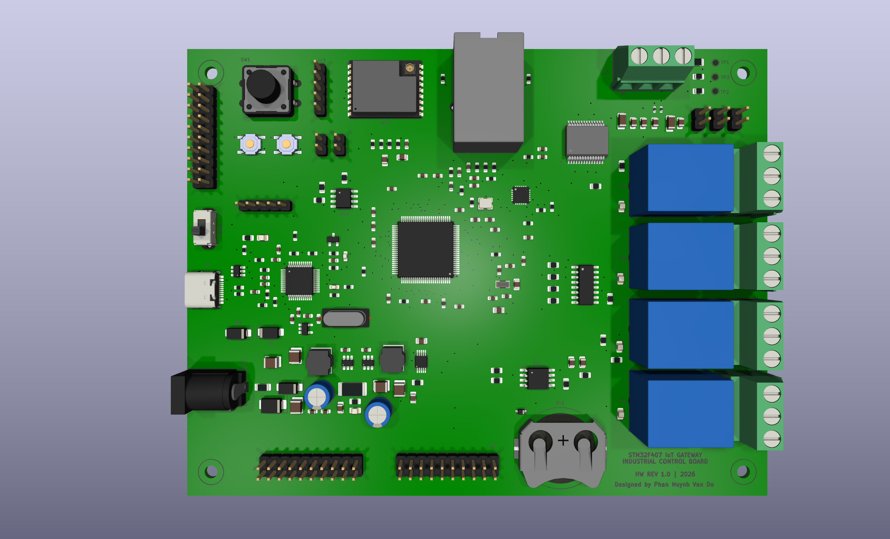
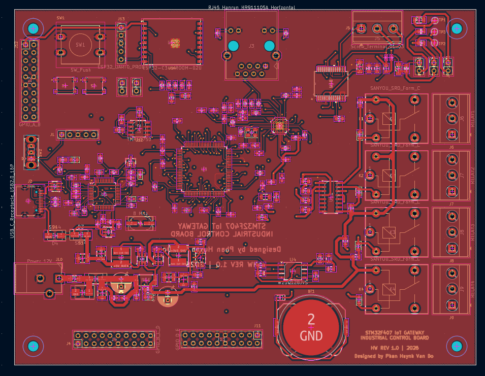
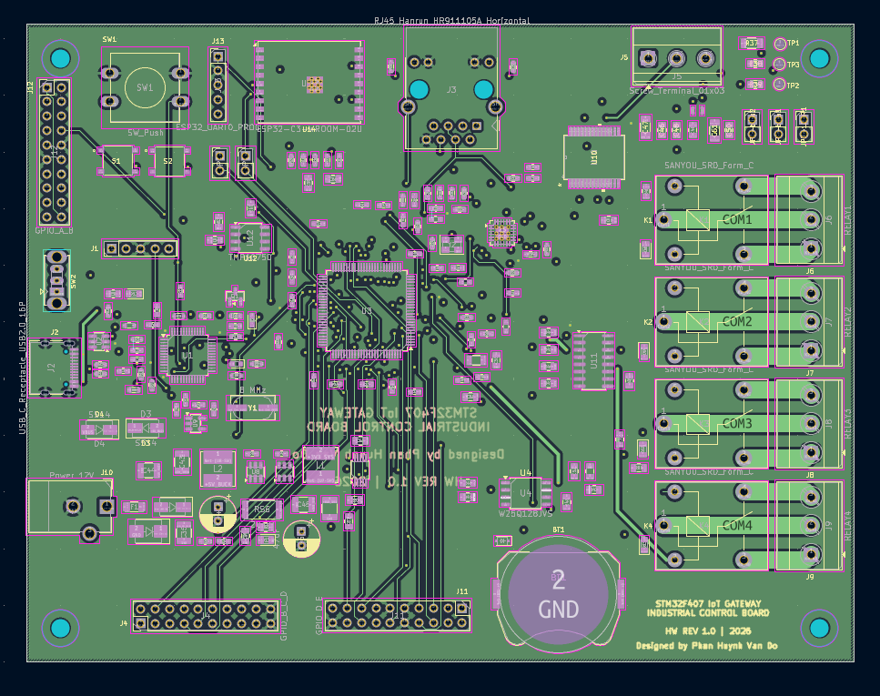
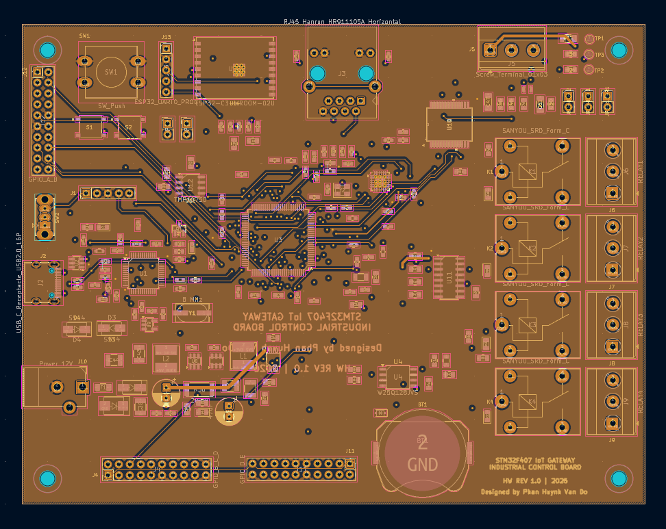
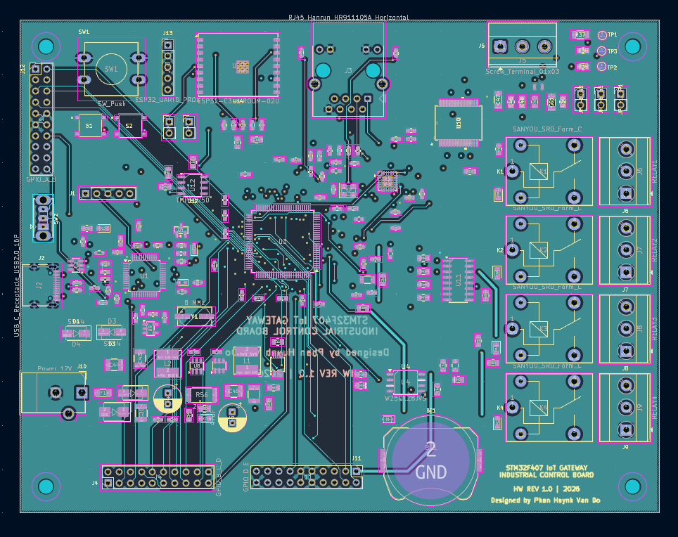
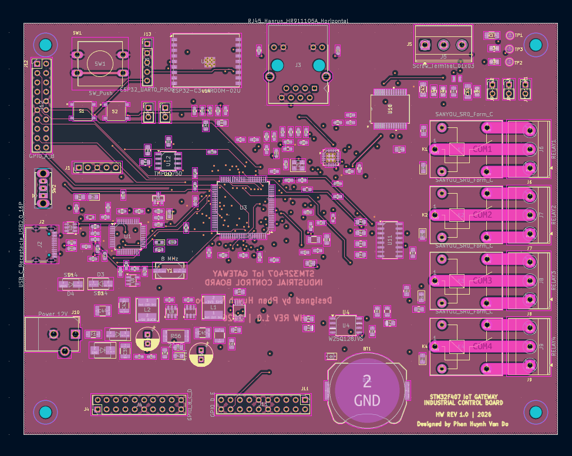
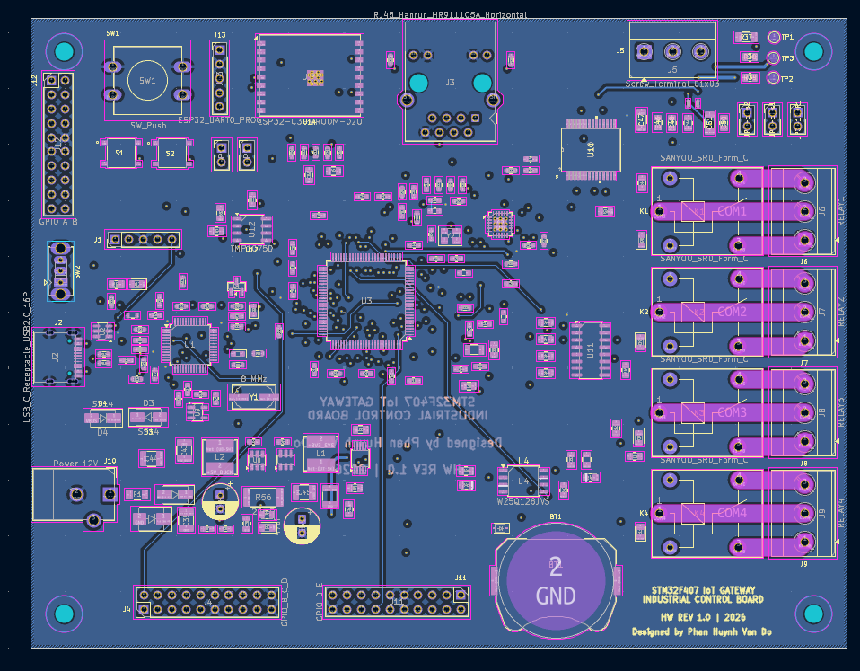
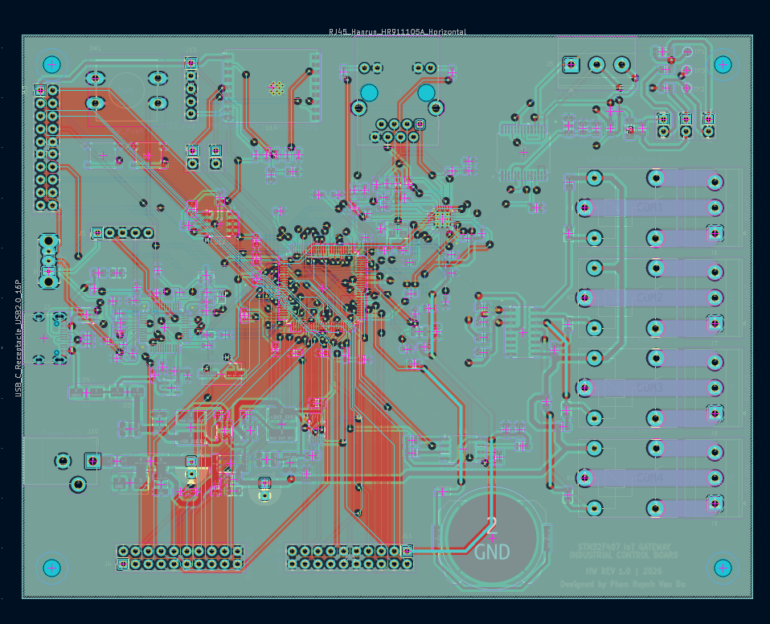
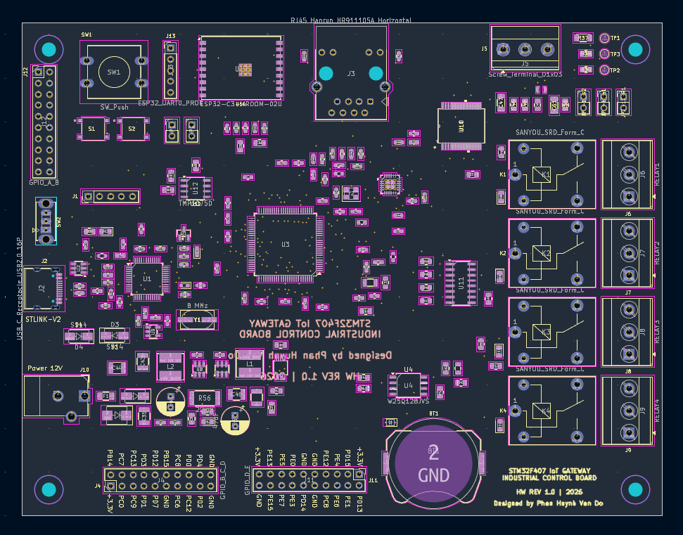
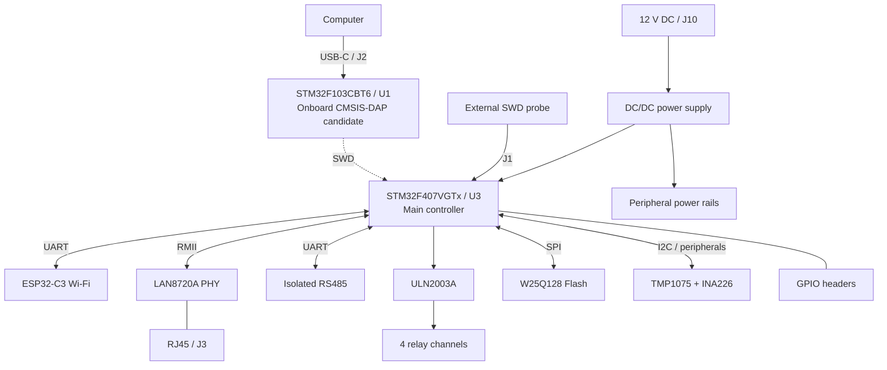

# STM32F407 IoT Gateway — 6-Layer PCB

**Custom industrial IoT gateway** based on the **STM32F407VGTx**, designed in **KiCad 10** with Wi-Fi, Ethernet, isolated RS485, four relay outputs, external SPI Flash and an onboard USB-C debug-probe circuit.


> [!IMPORTANT]
> **Trạng thái dự án:** Đã có **schematic, PCB layout 6 lớp, ảnh 3D, Gerber, BOM và mã nguồn firmware debug tham khảo**. Chưa có xác nhận bo mạch đã được lắp ráp, thử nghiệm điện hoặc kiểm chứng đầy đủ ERC/DRC. Không coi các file sản xuất là bằng chứng thiết kế đã sẵn sàng để chế tạo hàng loạt.
>
> **Firmware trong `firrmware_STLINKV2/` là dự án [dap42](https://github.com/devanlai/dap42) (CMSIS-DAP nguồn mở), không phải firmware ST-LINK/V2 chính hãng của STMicroelectronics.** Chưa xác nhận firmware này chạy trên PCB hiện tại mà không chỉnh sửa.

## 1. PCB 3D Preview

Các hình sau được xuất từ **project KiCad của bo mạch này**. Nhấn vào hình để mở ảnh gốc với độ phân giải cao.

### Góc nhìn tổng thể

[.png>)](<images/IoT_gateway_STM32F407(1).png>)

### Hai góc nhìn 3D bổ sung

| 3D View 01 | 3D View 02 |
| :---: | :---: |
| [](images/IoT_gateway_STM32F407.png) | [.png>)](<images/IoT_gateway_STM32F407(2).png>) |

## 2. PCB Layout — 6 Copper Layers

PCB sử dụng **6 lớp đồng**: `F.Cu`, `In1.Cu`, `In2.Cu`, `In3.Cu`, `In4.Cu`, `B.Cu`. Các hình bên dưới là ảnh từng lớp riêng biệt, đã lưu trong thư mục [`images/`](images/).

| Front Copper — `F.Cu` | Inner Copper 1 — `In1.Cu` |
| :---: | :---: |
| [](images/F_cu.png) | [](images/In1_cu.png) |

| Inner Copper 2 — `In2.Cu` | Inner Copper 3 — `In3.Cu` |
| :---: | :---: |
| [](images/In2_cu.png) | [](images/In3_cu.png) |

| Inner Copper 4 — `In4.Cu` | Back Copper — `B.Cu` |
| :---: | :---: |
| [](images/In4_cu.png) | [](images/B_cu.png) |

### Tổng hợp các lớp đồng

[](images/F_in1_in2_in3_in4_B.png)

### Bố trí footprint linh kiện

[](images/footprint.png)

> **Lưu ý:** Các ảnh trên mô tả PCB theo file thiết kế, không phải ảnh bo mạch vật lý đã sản xuất.

## 3. System Architecture



Sơ đồ khối thể hiện **kiến trúc thiết kế**; các giao tiếp chưa được xác nhận hoạt động trên phần cứng thực tế.

## 4. Hardware Overview

| Khối chức năng | Linh kiện / đầu nối | Vai trò |
| --- | --- | --- |
| Main MCU | **U3 — STM32F407VGTx** | Bộ điều khiển trung tâm, ARM Cortex-M4 |
| Onboard debug MCU | **U1 — STM32F103CBT6** | MCU dùng cho mạch USB-to-SWD dự kiến |
| Wireless | **U14 — ESP32-C3-WROOM-02U** | Wi-Fi, giao tiếp với MCU chính |
| Ethernet | **U6 — LAN8720A**, **J3 — HR911105A** | Ethernet PHY 10/100 Mbps và cổng RJ45 |
| Industrial bus | **U10 — ADM2861EBRNZ** | Truyền thông RS485 cách ly |
| Relay outputs | **K1–K4**, **U11 — ULN2003A** | 4 kênh relay có mạch driver |
| External Flash | **U4 — W25Q128JVS** | SPI NOR Flash |
| Temperature | **U12 — TMP1075D** | Giám sát nhiệt độ |
| Power monitoring | **U13 — INA226**, **R56 — 20 mΩ** | Đo điện áp và dòng điện qua shunt |
| RTC backup | **BT1** | Vị trí pin dự phòng |
| Expansion | **J4, J11, J12** | Header GPIO mở rộng |
| System power | **J10** | Nguồn DC 12 V cho hệ thống |
| Debug USB | **J2** | USB Type-C kết nối với U1 |
| External programming | **J1** | Header SWD nạp trực tiếp U3 |

### Power architecture

Các khối nguồn trên schematic gồm **AP63203WU (U7)**, **AP63205WU (U8)** và **AP2112K-3.3 (U9)**. Các net chính bao gồm `+12V_PROTECTED`, `+5V_BUCK`, `+3V3_SYS` và `+3V3_STLINK`.

> [!WARNING]
> **USB-C/J2 không được mặc định là nguồn cấp cho toàn bộ bo mạch.** Theo cấu trúc hiện tại, J2 phục vụ khối debug U1, còn U3 và hệ thống cần nguồn phù hợp từ đường DC 12 V. Phải kiểm tra sơ đồ nguồn trước khi nạp/debug hoặc nối nguồn đồng thời.

## 5. STM32 Programming & Debugging

Có **hai đường nạp/debug khác nhau** cho STM32F407 (U3).

### A. External ST-Link / CMSIS-DAP via J1

**J1 là cổng SWD dành cho U3 (STM32F407VGTx), không phải cổng nạp U1.**

| SWD signal | Target U3 |
| --- | --- |
| SWDIO / `T_DIO` | PA13 |
| SWCLK / `T_CLK` | PA14 |
| NRST / `T_RST` | NRST |
| GND | GND |
| VTref | 3.3 V target logic reference |

Cấp nguồn cho bo mạch theo thiết kế, sau đó kết nối một probe SWD bên ngoài với **J1 theo tên net trên schematic**. Dùng **STM32CubeProgrammer** với ST-Link chính hãng hoặc phần mềm tương thích với probe đang sử dụng. Không suy luận thứ tự chân J1 từ bảng này.

### B. Onboard USB-C debug via J2 and U1

Đường tín hiệu dự kiến:

`Computer → USB-C (J2) → STM32F103CBT6 (U1) → SWD → STM32F407VGTx (U3)`

| SWD signal | U1 — Debug MCU | U3 — Main MCU |
| --- | --- | --- |
| SWDIO / `T_DIO` | PB14 | PA13 |
| SWCLK / `T_CLK` | PB13 | PA14 |
| Reset / `T_RST` | PB0 | NRST |
| SWO / `T_SWO` | PA10 (theo schematic) | PB3 |

Để mạch debug onboard hoạt động, cần nạp và cấu hình firmware thích hợp vào U1, bảo đảm clock USB/SWD, reset, pin mapping và nguồn logic. **Không thể chỉ hàn STM32F103 mới lên PCB rồi cắm USB-C để máy tính tự nhận ST-Link.**

## 6. Onboard Debugger Firmware — dap42 / CMSIS-DAP

Mã nguồn được lưu tại [`firrmware_STLINKV2/`](firrmware_STLINKV2/) (**giữ nguyên tên thư mục hiện tại, bao gồm cách viết `firrmware`**).

> [!IMPORTANT]
> Thư mục trên chứa **[dap42](https://github.com/devanlai/dap42)**, một dự án **CMSIS-DAP open-source** hỗ trợ STM32F042/STM32F103 và có các cấu hình dành cho **phần cứng ST-LINK/V2 hoặc ST-LINK/V2-1**. Tên thư mục không có nghĩa đây là firmware ST-LINK/V2 chính hãng. Sau khi nạp dap42, probe hoạt động theo giao thức **CMSIS-DAP** (ví dụ với OpenOCD), **không phải thiết bị ST-Link chính hãng trong STM32CubeProgrammer**.

### Những gì có sẵn trong thư mục firmware

| Đường dẫn | Nội dung |
| --- | --- |
| [`firrmware_STLINKV2/src/`](firrmware_STLINKV2/src/) | Mã nguồn C cho CMSIS-DAP, USB, cấu hình phần cứng |
| [`firrmware_STLINKV2/src/targets.mk`](firrmware_STLINKV2/src/targets.mk) | Các target STM32F103, STLINKV2-DONGLE, STLINKV2-1 |
| [`firrmware_STLINKV2/Makefile`](firrmware_STLINKV2/Makefile) | Build targets và xuất firmware `.bin` |
| [`firrmware_STLINKV2/openocd/`](firrmware_STLINKV2/openocd/) | Cấu hình OpenOCD tham khảo |
| [`firrmware_STLINKV2/FLASHING.md`](firrmware_STLINKV2/FLASHING.md) | Hướng dẫn nạp firmware dap42 |
| [`firrmware_STLINKV2/README.md`](firrmware_STLINKV2/README.md) | Tài liệu dự án dap42 gốc |
| [`firrmware_STLINKV2/LICENSE`](firrmware_STLINKV2/LICENSE) | Giấy phép phần mềm của dự án dap42 |

**Khả năng phù hợp với PCB này:** Các đường `PB14 → SWDIO`, `PB13 → SWCLK` và `PB0 → NRST` của U1 tương ứng với cấu hình STM32F103 kiểu `stlinkv2-1` trong dap42. **Tuy nhiên, đường SWO trên schematic là `PA10` trong khi cấu hình mẫu dùng `PB11`;** ngoài ra còn phải kiểm tra USB pull-up, LED, GPIO khác và 8 MHz HSE trước khi flash. Chưa có bản firmware được chứng minh là tương thích toàn bộ pinout của PCB.

### Build firmware (tham khảo, chưa xác nhận cho PCB này)

Mã nguồn dap42 dùng **libopencm3**. Bản RAR được cung cấp **chưa chứa mã nguồn dependency này** trong thư mục `libopencm3/`; cần tải bổ sung trước khi build:

```bash
cd firrmware_STLINKV2
# Chỉ cần thực hiện khi thư mục libopencm3 chưa có mã nguồn
git clone https://github.com/libopencm3/libopencm3.git libopencm3

# Yêu cầu: GNU make và ARM GNU Toolchain (arm-none-eabi-*)
# Build ví dụ cho phần cứng profile ST-LINK/V2-1 tham khảo:
make DAP103-NUCLEO.bin
```

Bản `.bin` sinh ra bởi lệnh trên **không được khuyến nghị nạp trực tiếp lên U1** trước khi đối chiếu và điều chỉnh file `src/stm32f103/stlinkv2-1/target.c`, `config.h`, thiết lập clock và chân của PCB. Cần phương pháp **nạp lần đầu cho U1** bằng SWD hoặc bootloader thích hợp; **J1 chỉ phục vụ U3**.

**Upstream & licensing:** [devanlai/dap42](https://github.com/devanlai/dap42) · [dap42 hardware](https://github.com/devanlai/dap42-hardware) · [libopencm3](https://github.com/libopencm3/libopencm3). Mã nguồn bao gồm thành phần mang giấy phép ISC, Apache-2.0 và LGPLv3; khi phân phối phải tuân thủ các giấy phép kèm theo từng thành phần.

## 7. ESP32-C3 Wi-Fi

Module **ESP32-C3-WROOM-02U** cung cấp chức năng Wi-Fi. Header **J13 (`ESP32_UART0_PROG`)** trên schematic phục vụ UART0 để lập trình và kiểm tra module. Khi sử dụng bộ chuyển USB–UART ngoài, phải kiểm tra điện áp logic 3.3 V và chế độ boot thực tế.

## 8. Project Structure

```text
IoT_gateway_STM32F407/
├── README.md
├── IoT_gateway_STM32F407.kicad_pro      # KiCad project
├── IoT_gateway_STM32F407.kicad_sch      # Schematic
├── IoT_gateway_STM32F407.kicad_pcb      # 6-layer PCB layout
├── Schematic.pdf                       # PDF schematic
├── images/
│   ├── IoT_gateway_STM32F407.png       # 3D render
│   ├── IoT_gateway_STM32F407(1).png    # 3D render
│   ├── IoT_gateway_STM32F407(2).png    # 3D render
│   ├── F_cu.png
│   ├── In1_cu.png
│   ├── In2_cu.png
│   ├── In3_cu.png
│   ├── In4_cu.png
│   ├── B_cu.png
│   ├── F_in1_in2_in3_in4_B.png          # All layers preview
│   └── footprint.png                   # Component placement
├── production/
│   ├── IoT_gateway_STM32F407.zip       # Gerber + drill package
│   ├── bom.csv
│   ├── positions.csv
│   ├── designators.csv
│   └── netlist.ipc
├── firrmware_STLINKV2/                 # dap42 CMSIS-DAP source
│   ├── src/
│   ├── openocd/
│   ├── Makefile
│   ├── FLASHING.md
│   ├── LICENSE
│   └── README.md
└── library/                            # Custom symbols/footprints/models
```

### Quick links

- **[Mở thiết kế PCB KiCad](IoT_gateway_STM32F407.kicad_pcb)**
- **[Mở schematic KiCad](IoT_gateway_STM32F407.kicad_sch)** · **[Xem schematic PDF](Schematic.pdf)**
- **[Tải bộ Gerber + Drill](production/IoT_gateway_STM32F407.zip)**
- **[Xem BOM](production/bom.csv)** · **[Component placement](production/positions.csv)**
- **[Xem mã nguồn firmware CMSIS-DAP](firrmware_STLINKV2/)**
- **[Xem toàn bộ ảnh PCB](images/)**

## 9. Verification Checklist

- [x] Schematic được lưu trong project KiCad.
- [x] PCB layout **6 copper layers** đã có trong repository.
- [x] Đã xuất 3 ảnh 3D, 6 lớp đồng và 2 ảnh bổ sung.
- [x] Đã xuất Gerber/Drill, BOM và component placement files.
- [x] Có mã nguồn **dap42 CMSIS-DAP** làm firmware tham khảo cho U1.
- [x] Hoàn tất và xác nhận **ERC/DRC**, clearance, copper stackup, lớp cách ly.
- [ ] Kiểm tra đường nguồn 12 V, 5 V, 3.3 V và tách nguồn USB debug.
- [ ] Kiểm chứng thạch anh, USB, pin mapping và firmware CMSIS-DAP cho U1.
- [ ] Kiểm chứng Ethernet RMII/PHY, Wi-Fi, RS485, relay và cảm biến.
- [ ] Xác nhận quy trình nạp/khôi phục U1; thử nạp U3 qua U1 và qua debug onboard.
- [ ] Lắp prototype và thực hiện kiểm thử phần cứng trước khi sản xuất hàng loạt.

## 10. Safety & Licensing

- Không kết nối điện lưới AC hoặc tải công suất vào relay trước khi kiểm tra **clearance/creepage, cách ly, bảo vệ quá dòng, định mức relay và vỏ bảo vệ**.
- GPIO, UART, SWD phải dùng mức điện áp tương thích; không cấp 5 V vào chân logic 3.3 V nếu không được cho phép.
- File Gerber được cung cấp như **tài liệu thiết kế**, chưa phải chứng nhận đủ điều kiện sản xuất an toàn.
- **Phần cứng:** Chưa có file `LICENSE` riêng xác nhận giấy phép phát hành thiết kế PCB/schematic. Việc đăng lên GitHub không tự động chuyển quyền sử dụng phần cứng thành open-source hardware.
- **Firmware dap42:** Giữ nguyên thông báo bản quyền và các điều khoản trong [`firrmware_STLINKV2/LICENSE`](firrmware_STLINKV2/LICENSE) cũng như giấy phép thành phần phụ thuộc. Không hiểu nhầm đây là firmware chính hãng của ST.

---

**Designed by Phan Huynh Van Do** · **HW Rev 1.0 (design marking)** · **2026**

*STM32F407 IoT Gateway — custom embedded hardware for connected control and industrial interfaces.*
